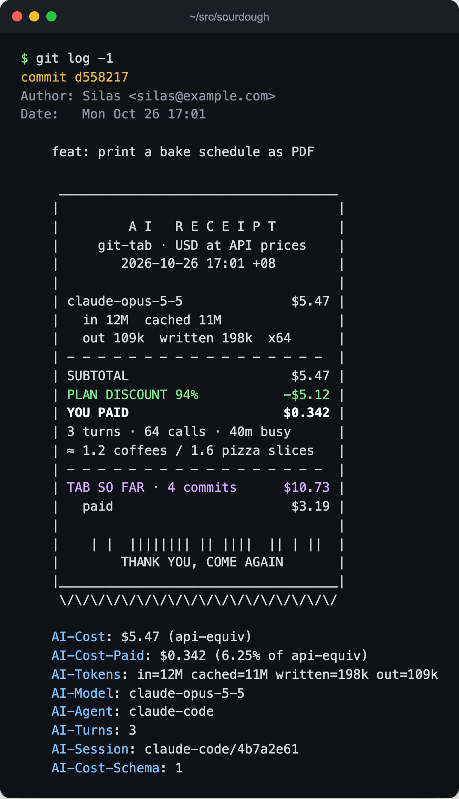

<h1 align="center">git-tab</h1>

<p align="center"><b>A receipt for every commit an AI helped write.</b><br>
Tokens, models and cost from Claude Code, Codex, pi, OpenCode and DeepSeek Harness, written into the commit message: at API prices, and at what your subscription actually charged.</p>

<p align="center">English · <a href="README.zh-CN.md">简体中文</a></p>

<p align="center">
<a href="LICENSE"></a>


</p>

<p align="center"></p>

## Install

```bash
curl -fsSL https://raw.githubusercontent.com/fish2lab/git-tab/main/install.sh | sh
```

Every repository on the machine now gets a receipt on each commit an agent worked on. In Claude Code, also add the plugin, so Claude can read receipts and record how you pay:

```
/plugin install git-tab --marketplace fish2lab/git-tab
```

Uninstall with `curl -fsSL https://raw.githubusercontent.com/fish2lab/git-tab/main/install.sh | sh -s -- --uninstall`; commits keep their receipts. Older git, Go, cloud sessions and other machines: [docs/install.md](docs/install.md).

## What it does

- **Bills each commit, never blocks one.** At commit time git-tab reads the agents' logs on your machine and prices every request since the last receipt at [models.dev](https://models.dev) rates: cache reads and writes, long-context tiers, Claude's fast mode, DeepSeek's peak hours. The hooks always exit 0 and add 50 to 150 ms to a commit.
- **Shows what you actually paid.** Tell it once that Claude Max costs you $125 a month for about $2,000 of API-priced usage, and Claude Code commits show 6.25% of the API price: SUBTOTAL, PLAN DISCOUNT, YOU PAID. A DeepSeek key at list price, a reseller at half price, a subscription measured from your own logs: [plans](docs/reference.md#plans-what-you-actually-pay).
- **Bills the right session.** When an agent commits, only its own session is on the receipt; parallel agents, work trees and amends each get their own share. Commits you type yourself pick up every session in the repository.
- **Keeps a running tab.** Each receipt ends with the total of every receipt in the branch's history, commits from teammates and other machines included.
- **Follows the code.** Receipts are plain git trailers, so they survive clones, pushes and new laptops. `git tab agents` adds one line to `AGENTS.md` and a cloud-session hook, so the next machine installs git-tab by itself, and a session moved between machines is never billed twice.
- **Stays local.** No server, no account, no API key. The only network call is a weekly price refresh.

## Read the bill

<p align="center"></p>

| command | |
|---|---|
| `git tab now` | the receipt the next commit would get |
| `git tab summary` | the project's bill, by model, agent and month |
| `git tab receipt` | the same, printed as one long receipt |
| `git tab badge` | a "built with $N of AI" badge for your README |
| `git tab plan` | your subscriptions and keys, and a month of usage by what pays for it |

## The trailers

The receipt is ordinary git trailers, readable by `git interpret-trailers`, `git log --format='%(trailers)'` and any agent:

```
AI-Cost: $5.47 (api-equiv)
AI-Cost-Paid: $0.342 (6.25% of api-equiv)
AI-Tokens: in=12M cached=11M written=198k out=109k
AI-Model: claude-opus-5-5
AI-Agent: claude-code
AI-Turns: 3
AI-Session: claude-code/4b7a2e61
AI-Cost-Schema: 1
```

Prefer one line? `git config --global tab.template minimal`. Every format, setting and rule is in [docs/reference.md](docs/reference.md).

## Supported agents

| agent | how a commit finds its session |
|---|---|
| Claude Code | `CLAUDE_CODE_SESSION_ID` |
| Codex | `CODEX_THREAD_ID` |
| pi | `PI_SESSION_ID` |
| OpenCode | `OPENCODE_SESSION_ID` |
| DeepSeek Harness, omp, ZCode | `GIT_TAB_SESSION=<agent>:<id>`, or the working directory |

Any other agent is one Go file: [teach it another agent](docs/reference.md#teach-it-another-agent).

## FAQ

**How much did AI cost to build this repository?** Run `git tab summary` in it. It adds up the receipts in the history, so it works in any clone, even on a machine without git-tab.

**How is this different from ccusage?** [ccusage](https://github.com/ryoppippi/ccusage) reports usage by day, month and session. git-tab ties the cost to the commit it produced, so it travels with the code and adds up per feature, branch or release.

**I pay a flat subscription. Is the API price meaningful?** It is what the same work would cost without one. With a [plan](docs/reference.md#plans-what-you-actually-pay), each receipt also shows your share of the subscription.

**Will it slow down or break my commits?** A commit takes 50 to 150 ms longer, depending on how long the session's log is. A hook that fails or runs past 4 seconds is dropped and the commit goes through without a receipt.

**Does anything leave my machine?** Only the weekly download of the public price table.

## Why "tab"

As in "put it on my tab". Thanks to [magpie](https://github.com/yetone/magpie) for its log parsers, [models.dev](https://models.dev) for prices, [ccusage](https://github.com/ryoppippi/ccusage) for the deduplication rules, trusty-mpm's [`commit_trailers.rs`](https://github.com/bobmatnyc/trusty-tools/blob/main/crates/trusty-mpm/src/core/commit_trailers.rs) for trailer placement and [Scopeon](https://github.com/sorunokoe/Scopeon) for the `AI-Cost` key.

MIT License.
