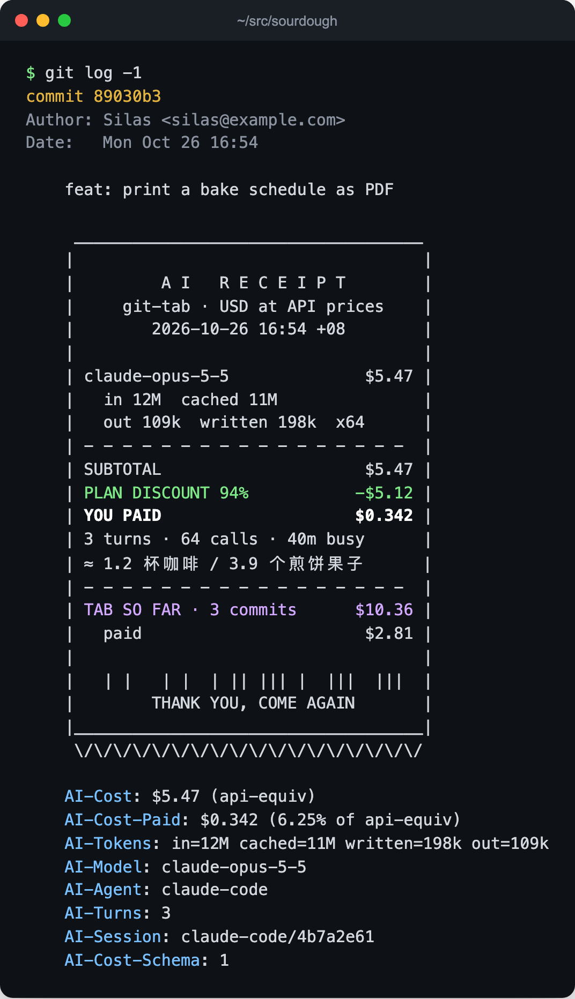
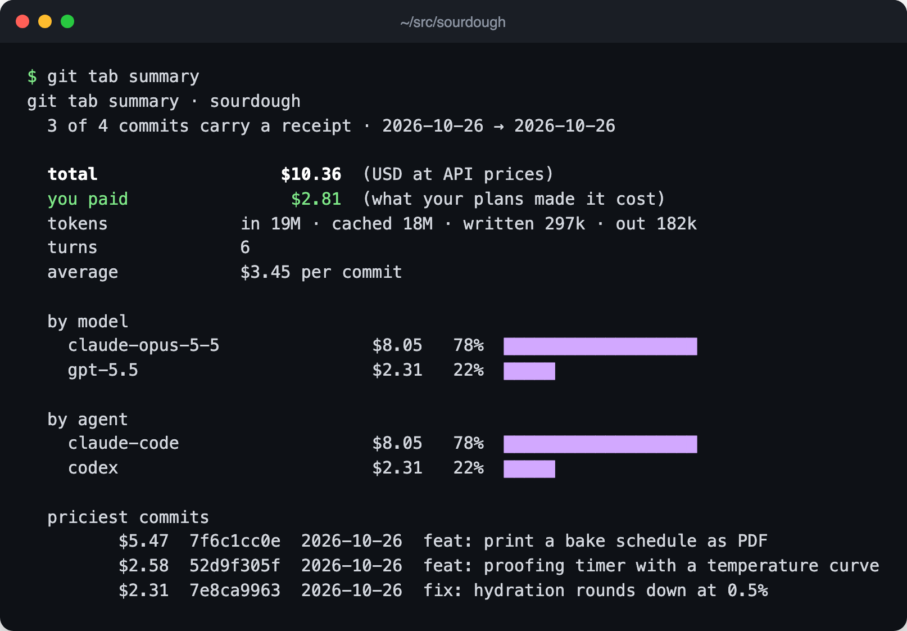

<h1 align="center">git-tab</h1>

<p align="center"><b>AI 参与写的每个 commit，都附一张小票。</b><br>
从 Claude Code、Codex、pi、OpenCode 和 DeepSeek Harness 的本地日志里算出 token、模型和花费，写进 commit message：按 API 官价算一份，再按你的订阅实际花了多少算一份。</p>

<p align="center"><a href="README.md">English</a> · 简体中文</p>

<p align="center">
<a href="LICENSE"></a>


</p>

<p align="center"></p>

## 安装

```bash
curl -fsSL https://raw.githubusercontent.com/fish2lab/git-tab/main/install.sh | sh
```

装完后，这台机器上每个仓库里 agent 参与过的 commit 都会带上小票。用 Claude Code 的话再装上插件，Claude 就能读懂小票、帮你登记订阅：

```
/plugin install git-tab --marketplace fish2lab/git-tab
```

卸载：`curl -fsSL https://raw.githubusercontent.com/fish2lab/git-tab/main/install.sh | sh -s -- --uninstall`，已有 commit 里的小票不受影响。旧版 git、用 Go 安装、云端会话和多台机器见 [docs/install.md](docs/install.md)（英文）。

## 它做什么

- **每个 commit 记账，从不拦 commit。** 提交时读取本机 agent 日志，把上一张小票之后的每次请求按 [models.dev](https://models.dev) 的价格逐条计价：缓存读写分开算，长上下文分档、Claude 快速模式、DeepSeek 高峰时段双倍都算进去。钩子永远返回 0，每次 commit 多花约 50 毫秒。
- **算出你实际付了多少。** 告诉它一次「Claude Max 每月 $125，大约用掉 $2,000 的 API 等价额度」，之后 Claude Code 的 commit 就按 API 价的 6.25% 记实付，小票上列出 SUBTOTAL、PLAN DISCOUNT、YOU PAID 三行。DeepSeek 官方 key 按原价、中转站打五折、订阅额度按本机日志自动测算，都可以登记，见[订阅与实付](docs/reference.md#plans-what-you-actually-pay)。
- **账记在对的会话上。** agent 自己 commit 时，小票只算它这个会话；并行的多个 agent、多个 worktree、`--amend` 各算各的。你手动 commit 时，仓库里所有会话的用量合在一张小票上。
- **小票底部有累计总额。** 每张小票最后一行是当前分支历史里所有小票的合计，队友和其他机器上的 commit 也算在内。
- **跟着代码走。** 小票就是普通的 git trailer，clone、push、换电脑都在。`git tab agents` 往 `AGENTS.md` 加一句话、给 Claude Code 云端会话加一个安装钩子，下一台机器上的 agent 会自己装好 git-tab；同一个会话在本地和云端之间来回挪，也不会重复记账。
- **只在本机运行。** 没有服务器、账号或 API key，唯一的联网是每周更新一次价格表。

## 看账单

<p align="center"></p>

| 命令 | |
|---|---|
| `git tab now` | 下一个 commit 会拿到的小票 |
| `git tab summary` | 整个项目的账单，按模型、agent、月份拆分 |
| `git tab receipt` | 同一份账单，打印成一张长小票 |
| `git tab badge` | README 用的「built with $N of AI」徽章 |
| `git tab plan` | 你登记的订阅和 key，以及最近 30 天用量各由谁付 |

## Trailer 格式

小票就是标准 git trailer，`git interpret-trailers`、`git log --format='%(trailers)'` 和任何 agent 都能直接读：

```
AI-Cost: $5.47 (api-equiv)
AI-Cost-Paid: $0.342 (6.25% of api-equiv)
AI-Tokens: in=12M cached=11M written=198k out=109k
AI-Model: claude-opus-5-5
AI-Agent: claude-code
AI-Turns: 3
AI-Session: claude-code/4b7a2e61
AI-Cost-Schema: 1
```

想只留一行：`git config --global tab.template minimal`。全部格式、设置和规则见 [docs/reference.md](docs/reference.md)（英文）。

## 支持的 agent

| agent | commit 时怎么认出自己的会话 |
|---|---|
| Claude Code | `CLAUDE_CODE_SESSION_ID` |
| Codex | `CODEX_THREAD_ID` |
| pi | `PI_SESSION_ID` |
| OpenCode | `OPENCODE_SESSION_ID` |
| DeepSeek Harness | `GIT_TAB_SESSION=dsh:<id>`，或按工作目录 |

再接一个 agent 只需要写一个 Go 文件，见[接入新 agent](docs/reference.md#teach-it-another-agent)。

## 常见问题

**这个仓库用 AI 写一共花了多少钱？** 在仓库里跑 `git tab summary`。它从 commit 历史里把小票加起来，任何 clone 都能算，那台机器装没装 git-tab 都行。

**和 ccusage 有什么区别？** [ccusage](https://github.com/ryoppippi/ccusage) 按天、月、会话统计用量；git-tab 把花费挂在产出它的 commit 上，账单跟着代码走，可以按功能、分支、版本汇总。

**我用的是包月订阅，API 价还有意义吗？** API 价是同样的活不订阅要花的钱。登记了[订阅](docs/reference.md#plans-what-you-actually-pay)之后，每张小票还会写出你这份订阅分摊下来的实付。

**会拖慢或者搞坏我的 commit 吗？** 每次 commit 多约 50 毫秒。钩子出错或者跑超过 4 秒就会被放弃，commit 照常完成，只是没有小票。

**会上传什么吗？** 只有每周下载一次公开的价格表。

## 为什么叫 tab

英文里 put it on my tab 是「记我账上」。感谢 [magpie](https://github.com/yetone/magpie) 的日志解析、[models.dev](https://models.dev) 的价格表、[ccusage](https://github.com/ryoppippi/ccusage) 的去重规则、trusty-mpm 的 [`commit_trailers.rs`](https://github.com/bobmatnyc/trusty-tools/blob/main/crates/trusty-mpm/src/core/commit_trailers.rs) 的 trailer 摆放规则，以及 [Scopeon](https://github.com/sorunokoe/Scopeon) 的 `AI-Cost` 字段名。

MIT 许可证。
